## Jean Carlo Benites Porras

Senior full-stack developer · Java/Spring, Angular, Go, Astro 
Lima, Peru · remote, UTC-5 · open to a remote role

[aquilabot.dev](https://aquilabot.dev/?lang=en) · [jeancarlobenites@gmail.com](mailto:jeancarlobenites@gmail.com) · [LinkedIn](https://www.linkedin.com/in/jean-carlo-aq) · [Resume (PDF)](https://aquilabot.dev/cv/Jean-Carlo-Benites-Porras-Resume-EN.pdf)

Since 2024 I have been the main developer of a regulated B2B SaaS platform used by about 400 companies. I moved it from Java 8 to 21 and Angular 10 to 17 without stopping production.

### What you can check

Every line carries its number and where it comes from.

| | | Source |
|--:|---|---|
| **400** | client companies use the platform I maintain | platform database, 2026 |
| **8&nbsp;→&nbsp;21** | Java versions with no production stop; Spring Boot 1.5 → 3, Angular 10 → 17 | git history |
| **0.74 s** | load time of a dashboard chart for a 1,100-user client, down from 14.6 s | measured in production, Oct 2026 |
| **252** | endpoints unchanged when moving from Spring MVC to WebFlux, for the next major version | next-version branch |
| **2,700+** | backend commits since 2023 | git history |

### Tests inside the real Baldur’s Gate 3

One command opens the real game, loads a hash-verified disposable save, drives it over a JSON channel and restores the mod configuration byte for byte. Every scenario ends in PASS or FAIL.

The lines above come from [a recording](assets/bg3-dead-aim.cast) of a run on October 24, 2026; only the timing is sped up. 847 in-game scenarios, 1,755 Vitest tests (counted October 27, 2026). [Code](https://github.com/Aquilabot/bg3-ingame-harness) · [case study](https://aquilabot.dev/en/work/bg3-tests/)

### CLX

A platform where many organizations run their esports tournaments, across games. I founded it and own it with two partners, and I am its sole developer: product, Go backend, Astro frontend and deployment. 82 REST endpoints, 7 tournament formats, 3 languages and a hash-chained audit log, on Go, PostgreSQL, Redis, WebSockets and Astro.

Live at [clx.pe](https://clx.pe) since October 2026 · [case study](https://aquilabot.dev/en/work/clx/)

### Open source

All MIT.

- **[bg3-ingame-harness](https://github.com/Aquilabot/bg3-ingame-harness)**: Test scenarios inside the real Baldur’s Gate 3, from one command. TypeScript, Lua · 440 tests
- **[brackets](https://github.com/Aquilabot/brackets)**: The 7 tournament formats from CLX as a library: brackets, Swiss, groups, leagues and stages. Go · v0.1.0 · used in CLX
- **[hashchain](https://github.com/Aquilabot/hashchain)**: An append-only log where changing a stored entry breaks the chain at the exact point. Go, PostgreSQL · v0.1.1 · used in CLX
- **[spring-gotenberg-reports](https://github.com/Aquilabot/spring-gotenberg-reports)**: PDF reports from Thymeleaf templates and Gotenberg, with parallel sections and progress over SSE. Java 21 · Spring Boot 4.1
- **[spring-idempotency](https://github.com/Aquilabot/spring-idempotency)**: The Idempotency-Key header for Spring Boot: a retry replays the response and the handler runs once. Java 21 · PostgreSQL · 69 tests
- **[ngx-sse-resource](https://github.com/Aquilabot/ngx-sse-resource)**: Server-Sent Events as Angular signals, with backoff reconnect and SSR support. Angular 22 · 27 tests · 1.7 kB
- **[share-links](https://github.com/Aquilabot/share-links)**: An image and short-link service that checks each image by its bytes, with per-IP limits and storage caps. Node 24 · no dependencies · 41 tests

Spanish native · English upper intermediate (B2) · [en español: aquilabot.dev](https://aquilabot.dev/?lang=es) · the terminal above is drawn by [scripts/render-run.mjs](scripts/render-run.mjs)
